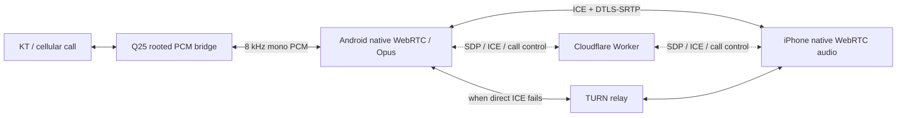

# Native WebRTC cloud calls

AirSIM's rooted Android Standalone and iPhone clients can carry cloud-call audio with native WebRTC instead of sending raw PCM over a WebSocket. Call signaling, ownership, APNs, pairing, durable answer/end commands, and SMS continue to use the existing Relay.



The WebRTC path uses the SDK's jitter buffer, concealment and congestion handling. It does not run through the legacy iPhone PCM jitter buffer or its time-pitch recovery node. Android bridges ten-millisecond native audio callbacks to the existing twenty-millisecond rooted PCM frames; it does not capture the Q25 microphone or play remote speech through its speaker.

## Compatibility and rollout

Install matching builds on both endpoints, then configure and deploy the Relay. The server selects WebRTC only when both clients advertise it, the iPhone requests it, rollout includes the device, and TURN is configured. Older Android agents, the legacy Go Agent, and Apple Watch retain PCM. A failed WebRTC negotiation is reported rather than silently switching the same call to a second media path.

For production external-network calls, configure either managed Cloudflare TURN or a TURN server using REST shared-secret authentication. A workers.dev HTTP/WebSocket endpoint is not itself a TURN server. No TURN service, production deployment, subscription, or device state is created by building this branch.

### Cloudflare Realtime TURN

Use a TURN key from the Cloudflare account that owns your service. See [Cloudflare's credential generation documentation](https://developers.cloudflare.com/realtime/turn/generate-credentials/). Configure these Worker variables:

```toml
TURN_PROVIDER = "cloudflare"
CLOUDFLARE_TURN_KEY_ID = "YOUR_TURN_KEY_ID"
TURN_TTL_SECONDS = "3600"
WEBRTC_TRANSPORT_READY = "true"
WEBRTC_ROLLOUT_PERCENT = "100"
```

Store `CLOUDFLARE_TURN_API_TOKEN` as a Worker secret, never in the app or repository. The Worker issues bounded, expiring client credentials and returns only those credentials to authenticated calls. Provisioning a TURN key and deploying Worker secrets are separate operational changes; use the deployment instructions in the [Relay guide](../push-relay-worker/README.md).

### Existing coturn service

Configure your TURN server with REST shared-secret authentication, then set:

```toml
TURN_PROVIDER = "coturn"
TURN_URLS = '["turn:turn.example.org:3478?transport=udp","turns:turn.example.org:5349?transport=tcp"]'
TURN_TTL_SECONDS = "3600"
WEBRTC_TRANSPORT_READY = "true"
WEBRTC_ROLLOUT_PERCENT = "100"
```

Store the matching secret as `TURN_SHARED_SECRET`. Optional `STUN_URLS` is a JSON array. Clients use the server-provided list; no public STUN/TURN account is hardcoded. See [coturn's configuration reference](https://github.com/coturn/coturn/blob/master/README.turnserver).

To stop new WebRTC selections, set `WEBRTC_TRANSPORT_READY=false` or `WEBRTC_ROLLOUT_PERCENT=0`. This changes subsequent call negotiation; it does not move an active call to PCM.

## Wire protocol and dependencies

The [protocol contract](webrtc-implementation-contract.md) defines call/session identity, candidate bounds, offer ownership, and the authenticated ICE endpoint. Android and iOS pin WebRTC SDK `144.7559.15` with artifact checksums. The SDK is published by [webrtc-sdk/android](https://github.com/webrtc-sdk/android) and [webrtc-sdk/Specs](https://github.com/webrtc-sdk/Specs); it is not an Android or Apple system framework. Each app includes the upstream BSD license, patent grant and supplemental dependency notices.

## Validation

Recorded local validation on 2026-10-17:

| Check | Result |
| --- | --- |
| Relay syntax and regression suite | 72 tests passed, including signaling ownership, stale sessions, TURN credentials/providers and legacy fallback |
| Android Standalone | Full JVM/regression suite, APK build/signing/alignment, 12 PCM/SDP checks and readiness regression cases passed |
| Android native media on API 35 ARM64 emulator | Two distinct generated tones decoded bidirectionally over host ICE and forced TURN; Opus, DTLS, relay selection, callback disposal and absence of physical audio objects verified |
| iOS simulator | Full 152-test run passed (147 existing tests plus five initial native tests); final twelve focused tests passed after readiness/role/wire-bound and agent reconnect-order fixes |
| iOS native media | Two generated signals decoded over host ICE and forced TURN; final source matched all 50 Swift/project files in the tested staging tree |
| Local TURN service | Task-local coturn 4.18.0: authenticated relay smoke test delivered 40/40 packets; stopped and temporary credentials removed after native tests |

Native loopback tests use generated tones and local test peers; they do not contact a carrier or record private conversations. They exercise the real SDK and audio device adapters, but bypass the full app WebSocket → ICE HTTP endpoint → rooted TCP call orchestration. Passing local tests does not establish KT/Q25 physical audio routing, real network handover, production Cloudflare TURN reachability, or subjective call quality. Production Relay deployment and physical app installation were not performed.

For device acceptance, install matching signed builds without clearing pairing data, configure a sandbox Relay and TURN provider, then test incoming/outgoing calls over distinct networks, two-way speech, mute/speaker/headset, Wi-Fi/cellular handover, background CallKit answer, hangup/reconnect, and a Watch/legacy call. Inspect negotiated transport and RTP/ICE diagnostics; never include call secrets, SDP, TURN passwords, or voice recordings in a bug report.
