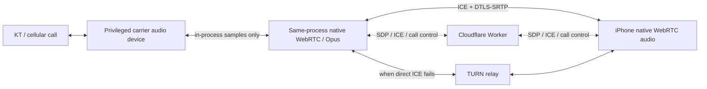

# Native WebRTC cloud calls

This draft migration moves AirSIM's privileged Android Standalone and iPhone clients can carry cloud-call audio with native WebRTC instead of sending raw PCM over a WebSocket. Call signaling, ownership, APNs, pairing, durable answer/end commands, and SMS continue to use the existing Relay.



The WebRTC path uses the SDK's jitter buffer, concealment and congestion handling. It does not run through the legacy iPhone PCM jitter buffer or its time-pitch recovery node. Android connects ten-millisecond native callbacks to its in-process privileged carrier device; it does not capture the Q25 microphone or play remote speech through its speaker.

## Migration gate

The native peer now shares the privileged carrier process. See [security, compatibility and device-validation gates](webrtc-only-migration.md). Q25 hidden vendor routes, native loading, and real two-way carrier calls are unverified for this architecture. Legacy source below is not device acceptance.

## Compatibility and rollout

Install matching builds on both endpoints, then configure and deploy the Relay. The server selects WebRTC only when both clients advertise it, the iPhone requests it, rollout includes the device, and TURN is configured. Unsupported old agents fail clearly; the Android runtime is Standalone and Watch controls audio on iPhone. There is no PCM fallback. A failed WebRTC negotiation is reported rather than silently switching the same call to a second media path.

For production external-network calls, configure either managed Cloudflare TURN or a TURN server using REST shared-secret authentication. A workers.dev HTTP/WebSocket endpoint is not itself a TURN server. No TURN service, production deployment, subscription, or device state is created by building this branch.

### Cloudflare Realtime TURN

Use a TURN key from the Cloudflare account that owns your service. See [Cloudflare's credential generation documentation](https://developers.cloudflare.com/realtime/turn/generate-credentials/). Configure these Worker variables:

```toml
TURN_PROVIDER = "cloudflare"
CLOUDFLARE_TURN_KEY_ID = "YOUR_TURN_KEY_ID"
TURN_TTL_SECONDS = "3600"
WEBRTC_TRANSPORT_READY = "true"
WEBRTC_ROLLOUT_PERCENT = "100"
```

Store `CLOUDFLARE_TURN_API_TOKEN` as a Worker secret, never in the app or repository. The Worker issues bounded, expiring client credentials and returns only those credentials to authenticated calls. Provisioning a TURN key and deploying Worker secrets are separate operational changes; use the deployment instructions in the [Relay guide](../push-relay-worker/README.md).

### Existing coturn service

Configure your TURN server with REST shared-secret authentication, then set:

```toml
TURN_PROVIDER = "coturn"
TURN_URLS = '["turn:turn.example.org:3478?transport=udp","turns:turn.example.org:5349?transport=tcp"]'
TURN_TTL_SECONDS = "3600"
WEBRTC_TRANSPORT_READY = "true"
WEBRTC_ROLLOUT_PERCENT = "100"
```

Store the matching secret as `TURN_SHARED_SECRET`. Optional `STUN_URLS` is a JSON array. Clients use the server-provided list; no public STUN/TURN account is hardcoded. See [coturn's configuration reference](https://github.com/coturn/coturn/blob/master/README.turnserver).

To stop new WebRTC selections, set `WEBRTC_TRANSPORT_READY=false` or `WEBRTC_ROLLOUT_PERCENT=0`. This changes subsequent call negotiation; it does not move an active call to PCM.

## Wire protocol and dependencies

The [protocol contract](webrtc-implementation-contract.md) defines call/session identity, candidate bounds, offer ownership, and the authenticated ICE endpoint. Android and iOS pin WebRTC SDK `144.7559.15` with artifact checksums. The SDK is published by [webrtc-sdk/android](https://github.com/webrtc-sdk/android) and [webrtc-sdk/Specs](https://github.com/webrtc-sdk/Specs); it is not an Android or Apple system framework. Each app includes the upstream BSD license, patent grant and supplemental dependency notices.

## Latency and stability diagnostics

Keep Cloudflare for control, APNs, and optional TURN. In WebRTC mode, the
selected ICE path carries audio. NetEq on both peers holds at most 50 Opus
packets (one second at 20 ms) and fast-accelerates when that buffer grows.
The legacy PCM jitter buffer and time-pitch node are not applied on top.

iOS writes `webrtc_stats` to its trace recorder; Android logs `standalone_webrtc_stats`
from the privileged media process. Samples
are taken approximately every five seconds and belong to one negotiation.
The selected path is resolved through the audio RTP transport's
`selectedCandidatePairId`, not an arbitrary gathered candidate. Addresses,
candidate strings, SDP, and TURN credentials are excluded from these records.

The iPhone trace currently cannot be turned on or read in the app, so only the
Android samples are available. They appear in logcat under the tag
`AirSIMBridge` (`adb logcat -s AirSIMBridge`), not in the Android in-app debug
log. See [Cloud audio startup diagnostics](cloud-audio-startup.md#diagnostics).

| Field | Interpretation |
| --- | --- |
| `path_rtt_ms` | Round-trip time reported for the selected ICE pair; not one-way or mouth-to-ear latency |
| `local-candidate.candidateType`, `remote-candidate.candidateType` | Whether the selected path uses host, reflexive, or relay candidates |
| `rx_jitter_ms` | Current RTP interarrival jitter estimate |
| `rx_buffer_ms` | Mean receive jitter-buffer residence during the latest sample interval |
| `rx_lost_packets` | Change in the receive loss estimate; may be negative when late packets correct earlier loss |
| `rx_concealed_samples`, `rx_concealment_pct` | Concealed audio samples and their share of received samples during the interval |
| `pcm_capture_drop_total`, `pcm_capture_conceal_total` | Android only. Cumulative carrier-capture frames discarded by the 60 ms/80 ms loopback cap, and 10 ms frames concealed because the attached carrier stalled. Either one is heard on the iPhone as a short gap. Outside the RTP loss count |
| `pcm_playback_drop_total`, `carrier_underrun_total` | Android only. Cumulative decoded frames the carrier loopback discarded at its 60 ms cap, and the platform's underrun count for the carrier AudioTrack. Either one is heard by the far end. Outside the RTP loss count |
| `pcm_playback_fill_total` | Android only. Cumulative 10 ms silence frames written to the carrier AudioTrack because no decoded frame arrived within 40 ms. It grows while the carrier is attached without running WebRTC playout: before the first offer is answered and during a renegotiation. Growth during speech means playout stalled, and the far end heard a faded gap |

The buffer mean uses the change in `jitterBufferDelay` divided by the change in
`jitterBufferEmittedCount`, following the [WebRTC statistics specification](https://www.w3.org/TR/webrtc-stats/).
Interval measurements are omitted on the first sample, after a stream/counter
reset, or when their denominator is zero. Missing metrics mean unavailable,
not zero. Unselected candidate pairs must not influence the displayed RTT.

Comparing both endpoints separates the causes: increasing RTT/jitter/loss points
to transport trouble; stable path metrics with increasing receive-buffer
residence points to local playout accumulation. Until the iPhone trace is
readable again, only the Android side of that comparison is available. These
are diagnostic clues, not proof of the precise
source of delay. The telephony loopback is outside that receive-buffer
measurement. Once the carrier device is attached, its clock drives both
loopback directions: WebRTC capture waits for each carrier frame, and NetEq
decodes the next frame only when the carrier AudioTrack has room. A separate
10 ms timer would drift against the modem clock and periodically insert or
drop 10 ms of audio, which is heard as a pop. The timer runs only before the
carrier attaches and after the carrier has made no progress for 100 ms.
A frame the loopback must still discard or conceal is joined to its neighbors
with a 5 ms ramp. Each app queue holds at most 60 ms. The capture queue also
drops audio older than 80 ms; carrier backpressure bounds the playback queue
instead. The carrier AudioTrack keeps an 80 ms floor when that is above the
platform minimum. Because the carrier clock keeps that buffer full, it is a
steady part of the iPhone-to-carrier delay rather than one that drifts until it
starves or overflows. Acoustic output and a platform
minimum larger than 80 ms remain outside this cap. This bound is not a
listening-quality result.

WebRTC decodes audio only while a negotiated peer is playing. The carrier can be
attached without one: when the call is already active before the iPhone's offer
arrives, on every rebuild during an active call, and across a renegotiation.
Android removes an AudioTrack that gets no data from its output after about 50
mixer cycles and tells audio policy that the client stopped. The carrier uplink
therefore never leaves the track empty. When no decoded frame arrives for 40 ms
it writes 10 ms silence frames at the carrier clock until one does. 40 ms is
half the 80 ms buffer floor, so the track still holds audio when silence
starts. With playout running, a decoded frame follows within a few milliseconds
of the queue having room, so no silence is added and the carrier clock still
paces NetEq. Silence adds no delay beyond the AudioTrack buffer that steady
state already keeps full. The first silence frame fades the last speech out and
the next decoded frame fades in.

## Sample preservation and voice negotiation

The carrier uplink now retains the unwritten tail of a decoded PCM frame when Android accepts only part of a write. Previously a partial nonblocking write during a temporarily missing route could discard the tail and splice the next frame directly onto it. A generated 400 Hz fixture reproduced 320 expected bytes becoming 240 bytes, a missing 5 ms at the current 8 kHz PCM16 rate. The corrected path preserves the sequence byte-for-byte. It validates returned sample counts, checks the route again before every retry, retains the existing 300 ms missing-route limit, and stops on device or queue closure. A reported non-telephony route remains forbidden. No buffer size or route-verification threshold was relaxed.

Voice SDP policy is applied within each active audio section, using that section's offered Opus payload. Missing `fmtp` now receives the intended mono, FEC and DTX parameters; whitespace/case variants of the parameters the app owns cannot leave conflicting values behind. Unrelated codec limits and non-audio sections are preserved. These changes make the existing policy reliable; they do not raise bitrate, change the 20 ms packet duration or reduce NetEq's jitter tolerance. Negotiating in-band FEC is not proof that any particular lost packet was repaired.

Android carrier capture and injection remain 8 kHz mono. Raising the WebRTC rate or bitrate alone cannot restore frequency content already absent from that carrier path. Wider-band carrier routing needs physical OEM support and route verification before it can be enabled. The iPhone-to-carrier partial-write fix addresses a demonstrated sample-loss path; no new evidence justified changing the carrier-to-iPhone queue, clock, or concealment limits.

The installed Android 86 version was verified before this work, but no post-update call timing or quality samples remained in logcat. Tests use generated samples and synthetic/native local peers, never private recordings. Physical first-speech delay, loss recovery, network handover and subjective speech quality remain separate acceptance checks.

## Validation

Recorded local validation on 2026-10-17:

| Check | Result |
| --- | --- |
| Relay syntax and regression suite | 72 tests passed, including signaling ownership, stale sessions, TURN credentials/providers and legacy fallback |
| Android Standalone | Full JVM/regression suite, APK build/signing/alignment, 12 PCM/SDP checks and readiness regression cases passed |
| Android native media on API 35 ARM64 emulator | Two distinct generated tones decoded bidirectionally over host ICE and forced TURN; Opus, DTLS, relay selection, callback disposal and absence of physical audio objects verified |
| iOS simulator | Full 152-test run passed (147 existing tests plus five initial native tests); final twelve focused tests passed after readiness/role/wire-bound and agent reconnect-order fixes |
| iOS native media | Two generated signals decoded over host ICE and forced TURN; final source matched all 50 Swift/project files in the tested staging tree |
| Local TURN service | Task-local coturn 4.18.0: authenticated relay smoke test delivered 40/40 packets; stopped and temporary credentials removed after native tests |

Quality-telemetry follow-up on 2026-10-17: the iOS focused suite passed 16
tests; its forced-TURN test was skipped because no temporary TURN configuration
was supplied for this run. The native host-ICE test was then rerun successfully
with an assertion that the real SDK report resolves both selected candidates.
Android's complete JVM regression suite and Standalone APK build/signature
verification passed. Audio-buffer policies and production deployment were
unchanged.

Native loopback tests use generated tones and local test peers; they do not contact a carrier or record private conversations. They exercise the real SDK and audio device adapters, but bypass the full app WebSocket → ICE HTTP endpoint → rooted TCP call orchestration. Passing local tests does not establish KT/Q25 physical audio routing, real network handover, production Cloudflare TURN reachability, or subjective call quality. Production Relay deployment and physical app installation were not performed.

For device acceptance, install matching signed builds without clearing pairing data, configure a sandbox Relay and TURN provider, then test incoming/outgoing calls over distinct networks, two-way speech, mute/speaker/headset, Wi-Fi/cellular handover, background CallKit answer, hangup/reconnect, and a Watch/legacy call. Inspect negotiated transport and RTP/ICE diagnostics in Android logcat; the iPhone trace is not currently readable. Never include call secrets, SDP, TURN passwords, or voice recordings in a bug report.
